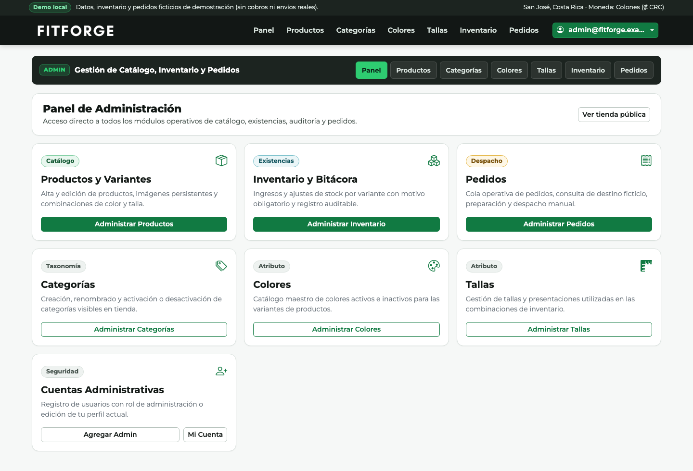

# FitForge

**Tienda deportiva web en Java y Spring Boot con catálogo por variantes, confirmación transaccional de pedidos y gestión de inventario.**

FitForge conecta el flujo de compra de un cliente con la operación diaria de la tienda: explorar productos por categoría, elegir combinación de talla y color, confirmar un pedido con validación en servidor y dar seguimiento a su preparación y despacho. Cada compra descuenta existencias de forma atómica en MySQL y genera un comprobante persistente asociado a la cuenta del comprador.

El proyecto nació en 2025 como un desarrollo académico colaborativo de la carrera de Ingeniería en Desarrollo de Software en la Universidad Fidélitas y fue retomado en 2026 para completar la persistencia de pedidos, la trazabilidad de inventario, el entorno reproducible en contenedores y el refinamiento de la interfaz. Funciona como entorno de demostración local con datos ficticios (no procesa cobros reales, no emite facturas fiscales ni conecta con transportistas o servicios de correo externos).

[Instalación con Docker](docs/local/SETUP.md) · [Caso de estudio](docs/portfolio/CASE-STUDY.md) · [Contribuciones y créditos](CONTRIBUTIONS.md) · [Verificación y alcance](docs/portfolio/VERIFICATION.md)

## Capacidades principales

- **Experiencia de compra (Cliente):** catálogo con búsqueda por texto y filtros por categoría, talla, color y rango de precios; ficha de producto con selección interactiva de variantes y existencias por combinación; carrito en sesión; confirmación con datos de entrega de demostración; comprobante persistente e historial propio de pedidos (`/pedidos`).
- **Operación de tienda (Administración):** barra de navegación unificada para gestionar productos con carga de imágenes, categorías, colores, tallas y variantes; registro de ingresos y ajustes de inventario con motivo obligatorio y bitácora auditable; bandeja de pedidos con filtros por estado, detalle de eventos y flujo `Pendiente` → `En preparación` → `Despachado`.
- **Consistencia de datos:** la confirmación del pedido valida precios y stock vigentes bajo bloqueo en base de datos, descuenta existencias y registra cabecera y líneas en una sola transacción. Los reintentos con la misma clave de operación son idempotentes y cualquier cambio de precio previo al cierre exige reconfirmación explícita del comprador.
- **Control de acceso:** autenticación con contraseñas en BCrypt, separación de permisos entre roles `USER` y `ADMIN`, protección CSRF en operaciones de cambio de estado y verificación de propietario para impedir la consulta de comprobantes ajenos.

## Stack tecnológico y versiones

| Componente | Versión configurada en el proyecto |
| --- | --- |
| Java | 21 (runtime Eclipse Temurin `21.0.6_7` en contenedor) |
| Spring Boot | `3.4.2` (Spring MVC, Spring Security, Spring Data JPA, Validation, Mail) |
| Persistencia y base de datos | Hibernate / JPA y Spring JDBC sobre MySQL `8.4.4` |
| Vistas y frontend | Thymeleaf, Bootstrap `5.3.3`, JavaScript y CSS propio |
| Librerías web declaradas en POM | jQuery `3.7.1`, Popper `2.11.7`, Font Awesome `6.7.1` |
| Construcción y proxy HTTP | Maven `3.9.9`; Nginx `1.28.0-alpine` |
| Entorno de ejecución | Docker Compose con imágenes de aplicación, base de datos y proxy fijadas por digest |

Las versiones están definidas en [pom.xml](InitializrSpringbootProject/pom.xml), [Dockerfile](Dockerfile) y [compose.yaml](compose.yaml). Aunque el backend y la base de datos se ejecutan íntegramente en contenedores locales, las plantillas cargan fuentes y recursos web externos en el navegador.

## Arquitectura, seguridad y consistencia

La aplicación sigue una arquitectura monolítica MVC con renderizado en servidor. Los controladores HTTP delegan la lógica en servicios de dominio que coordinan repositorios JPA y consultas JDBC sobre MySQL. Thymeleaf genera las vistas HTML y el código JavaScript del cliente gestiona el modal de filtros y la selección interactiva de variantes.

```text
Navegador → Nginx (127.0.0.1) → Spring MVC / Spring Security
                                           ↓
                                  Servicios de dominio
                                     ↓            ↓
                               JPA + JDBC      Uploads (/media)
                                     ↓         volumen Docker
                                   MySQL
```

- **Transacciones y concurrencia:** las operaciones que compiten por inventario bloquean las filas implicadas en un orden estable antes de validar stock o actualizar productos. Al avanzar un pedido a preparación o despacho, se actualiza el estado y se inserta el evento correspondiente sin volver a descontar unidades.
- **Idempotencia en la confirmación:** cada intento de compra vincula una clave de operación y una huella del carrito y destino al usuario autenticado. Si el navegador reenvía la misma solicitud, el servicio devuelve el pedido ya registrado; si el resultado previo quedó pendiente de verificación, conserva la clave para consultar el estado antes de repetir la escritura.
- **Almacenamiento de imágenes:** la subida de fotografías valida formato (`PNG`, `JPG/JPEG` hasta 5 MB), firma binaria, decodificación y dimensiones. Los archivos se escriben con nombre UUID en un volumen dedicado (`/media/`) mediante un archivo temporal previo y limpieza compensatoria si la transacción en MySQL revierte. Al no existir una transacción distribuida entre el sistema de archivos y la base de datos, ante fallos inciertos se prioriza conservar el archivo para evitar referencias rotas.
- **Trazabilidad operativa:** cada ingreso o ajuste manual de stock registra el administrador responsable y el motivo, mientras que las transiciones del pedido guardan una bitácora de eventos con marca de tiempo.
- **Aislamiento en contenedores:** la aplicación se ejecuta sin privilegios de `root`, con sistema de archivos raíz de solo lectura y una cuenta MySQL restringida a operaciones DML (`SELECT`, `INSERT`, `UPDATE`, `DELETE`). La base de datos y el backend se comunican en una red interna y Nginx publica el servicio únicamente en la interfaz local `127.0.0.1`.

El análisis detallado de las decisiones de diseño se encuentra en el [caso de estudio](docs/portfolio/CASE-STUDY.md) y en el [contrato de pedidos](docs/local/ORDERS.md).

## Recorrido visual

Capturas tomadas sobre la aplicación ejecutándose en Docker con datos de demostración:

[](docs/portfolio/screenshots/catalogo.png)

[](docs/portfolio/screenshots/administracion.png)

[Ver ficha de producto en vista móvil](docs/portfolio/screenshots/producto-movil.png): selección de talla y color por variante, existencias disponibles y agregado al carrito.

## Instalación y ejecución con Docker

Requisitos: Docker con Docker Compose y Python 3 estándar. Java, Maven, MySQL y Node corren dentro de contenedores, por lo que no es necesario instalarlos en la máquina local.

Desde la raíz del repositorio, define un nombre de proyecto, etiqueta de imagen y puerto libres. **Es necesario incluir ambos archivos Compose sobre un volumen de base de datos nuevo**, ya que los scripts SQL inicializan el esquema y los datos al crear el contenedor por primera vez (no hay migración automática sobre volúmenes de versiones anteriores):

```sh
export FITFORGE_IMAGE_TAG=portfolio-local-20261118
export COMPOSE_PROJECT_NAME=fitforge-portfolio-local-20261118
export FITFORGE_PORT=18128
python3 scripts/docker-build.py --tag "$FITFORGE_IMAGE_TAG"
docker compose -f compose.yaml -f compose.order-ops.yaml config --quiet
docker compose -f compose.yaml -f compose.order-ops.yaml up -d --no-build --wait db app web
```

Una vez iniciados los contenedores, abre <http://127.0.0.1:18128/tienda/listado>.

Cuentas de prueba incluidas en el entorno local:
- **Administrador:** `admin@fitforge.example`
- **Cliente:** `cliente@fitforge.example`
- **Contraseña común de demostración:** `FitForge-demo-2026!`

Para detener los contenedores conservando los datos del volumen:

```sh
docker compose -f compose.yaml -f compose.order-ops.yaml stop
```

La [guía de instalación y pruebas locales](docs/local/SETUP.md) detalla la topología de redes, límites de memoria y ejecución aislada de la suite de pruebas. Si dispones de recursos de memoria ajustados en Docker, ejecuta el build, las pruebas y la demo de forma secuencial, utilizando siempre un proyecto distinto para las pruebas automatizadas.

## Pruebas y verificación

| Nivel de verificación | Cobertura y resultado comprobado | Entorno de ejecución |
| --- | --- | --- |
| Suite de integración backend (`a40eb6a`) | `150` pruebas en `mvn test` y `150` en `mvn package` (`0` fallos, `0` errores, `0` omitidas), más `2` casos de concurrencia de imágenes sobre socket HTTP | Contenedor de pruebas contra MySQL `8.4.4` real en Docker |
| Suite con refinamiento de interfaz (`8c73ecea`) | `151` pruebas en `mvn test` y `151` en `mvn package` (`0` fallos, `0` errores, `0` omitidas) | Imagen de pruebas en contenedor aislado contra MySQL real, sin montaje de fuentes locales |
| Contrato JavaScript de interfaz | Validación satisfactoria de DOM, manejo de foco en modal y navegación de filtros (`scripts/test-rutinas.js`) | Contenedor `node:24.22.1-alpine` sin acceso a red y con repositorio en solo lectura |
| Flujo de navegador y persistencia | Recorrido completo de catálogo, alta de producto e imagen, movimiento de stock, compra, preparación y despacho; datos e imágenes verificados tras `--force-recreate` | Navegador contra el stack Docker (`db`, `app`, `web`) en resoluciones de escritorio y móvil |

El desglose de escenarios cubiertos y los comandos exactos para reproducir cada ejecución se detallan en [VERIFICATION.md](docs/portfolio/VERIFICATION.md).

## Origen del proyecto y mi contribución

Coordiné y organicé este proyecto junto con mis compañeros en 2025 como parte de la carrera de Ingeniería en Desarrollo de Software en la Universidad Fidélitas. En esa etapa inicial construimos en equipo la base funcional de la tienda en Spring Boot: el catálogo con variantes de talla y color, el carrito de compras, el control de acceso y las primeras pantallas administrativas.

En 2026 retomé el proyecto para completar la operación de la tienda y mejorar su interfaz, manteniendo la base original y los aportes del equipo. Organicé esta evolución mediante entregas incrementales, apoyándome en herramientas de desarrollo asistido por IA junto con pruebas automatizadas sobre MySQL y validación directa en navegador, para diseñar e integrar:

- **Entorno Docker reproducible** con inicialización completa de esquema, límites de recursos, proxy Nginx en loopback y endurecimiento de permisos de contenedor y base de datos.
- **Flujo de pedidos persistente e idempotente**, con descuento transaccional de stock bajo bloqueo, reconfirmación ante cambios de precio y comprobantes protegidos por propietario.
- **Gestión consistente de imágenes y catálogo**, con validación binaria de archivos, almacenamiento en volumen dedicado (`/media/`) y compensación ante fallos de transacción.
- **Operación administrativa y renovación visual**, incorporando la bitácora auditable de movimientos de inventario, las transiciones de preparación y despacho de pedidos, la navegación administrativa unificada y el catálogo con divulgación progresiva.

El registro de las dos etapas y el reconocimiento al trabajo del equipo universitario se amplían en [CONTRIBUTIONS.md](CONTRIBUTIONS.md).

## Alcance de la demostración y recursos

- **Límites funcionales de la demo:** la aplicación opera exclusivamente con datos ficticios para evaluación técnica. No integra pasarelas de pago, facturación electrónica, transportistas ni servidores SMTP reales, y no incluye flujos de cancelación o devolución de pedidos.
- **Decisiones del modelo heredado:** el carrito se mantiene en la sesión HTTP sin reservar stock antes de confirmar el pedido, y los importes monetarios conservan el tipo `DOUBLE` del esquema original acotado mediante validaciones de dos decimales con `BigDecimal`.
- **Autoría y activos gráficos:** el historial del repositorio conserva los commits originales del equipo académico. Las imágenes de productos presentes en los datos de ejemplo se emplean únicamente con fines de demostración técnica en entorno local; su estado y procedencia se documentan en [ASSETS.md](docs/portfolio/ASSETS.md).
