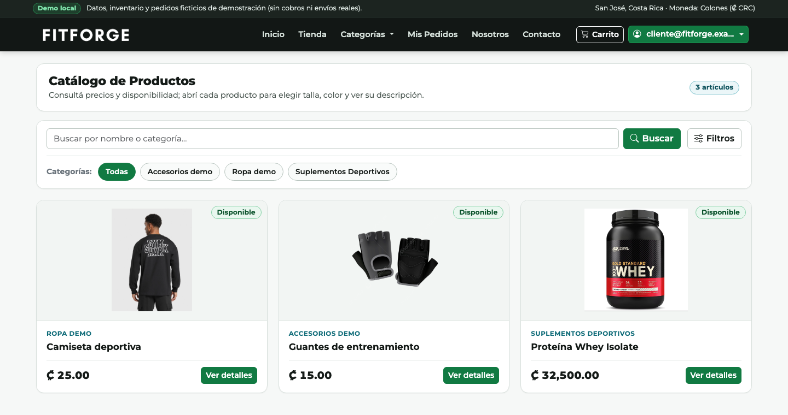

# FitForge

**Tienda deportiva de demostración con catálogo por variantes, pedidos persistentes y administración de inventario.**

Aplicación web Java que conecta la experiencia de compra con la operación administrativa: consultar disponibilidad, elegir talla y color, confirmar un pedido y seguir su preparación. El servidor valida precios y existencias; los cambios de inventario y estado quedan registrados en la base de datos.

Proyecto académico colaborativo de 2025, recuperado y ampliado en 2026. Esta versión es un **candidato local para revisión de portafolio**. Utiliza datos ficticios: no procesa pagos, no realiza envíos y su comprobante no es una factura fiscal. La publicación está pendiente de revisión de historia sensible, créditos y permisos de recursos gráficos.

[Instalación Docker](docs/local/SETUP.md) · [Caso de estudio](docs/portfolio/CASE-STUDY.md) · [Contribuciones y créditos](CONTRIBUTIONS.md) · [Verificación y límites](docs/portfolio/VERIFICATION.md)

## Recorrido visual

Capturas de la aplicación real en Docker, tomadas sobre la base UI `8c73ecea` con datos de demostración. Se recortó el pie de página; no se fabricaron pantallas. Las imágenes de productos visibles conservan permisos de redistribución pendientes: véase [procedencia de recursos](docs/portfolio/ASSETS.md).

[](docs/portfolio/screenshots/catalogo.png)

[](docs/portfolio/screenshots/administracion.png)

[Ver detalle de producto en móvil](docs/portfolio/screenshots/producto-movil.png): selección de talla y color, existencias por variante y agregado al carrito.

## Qué resuelve

- **Cliente:** catálogo, búsqueda y filtros; detalle de producto con variantes; carrito por sesión; confirmación con destino ficticio y consentimiento; comprobante persistente e historial propio.
- **Administración:** productos e imágenes, categorías, colores, tallas y variantes; ingresos y ajustes de inventario con motivo; consulta y transición de pedidos de Pendiente a En preparación y Despachado.
- **Consistencia:** una confirmación descuenta stock y persiste cabecera y líneas en una transacción. Reenviar el mismo intento recupera el pedido original; un precio cambiado exige reconfirmación.
- **Control de acceso:** autenticación JDBC/BCrypt, roles de cliente y administración, CSRF y validación de propietario al consultar comprobantes.

## Stack reproducible

| Componente | Versión fijada en el proyecto |
| --- | --- |
| Java | 21; runtime Temurin 21.0.6_7 |
| Spring Boot | 3.4.2 |
| Persistencia | Spring Data JPA, Hibernate y JDBC; MySQL 8.4.4 |
| Vistas | Thymeleaf, Bootstrap 5.3.3, JavaScript y CSS |
| Recursos web | jQuery 3.7.1, Popper 2.11.7, Font Awesome 6.7.1 en POM |
| Build y entrada HTTP | Maven 3.9.9; Nginx 1.28.0-alpine |
| Entorno | Docker Compose; imágenes de backend, BD y proxy fijadas por digest |

Las versiones proceden de [pom.xml](InitializrSpringbootProject/pom.xml), [Dockerfile](Dockerfile) y [compose.yaml](compose.yaml). El navegador también carga recursos externos; la demo no es completamente autónoma sin conexión.

## Arquitectura y decisiones técnicas

Monolito MVC con renderizado en servidor: los controladores reciben HTTP, los servicios aplican reglas de negocio y los repositorios/DAO acceden a MySQL. Thymeleaf presenta el resultado; el JavaScript complementa filtros y selección de variantes. No hay una API ni un frontend desplegados como servicios independientes.

```text
Navegador → Nginx (loopback) → Spring MVC / Security
                                  ↓
                         Servicios de negocio
                             ↓           ↓
                     JPA + JDBC       Uploads
                             ↓        volumen propio
                           MySQL
```

- **Transacciones y concurrencia:** bloqueo de filas y orden estable de acceso para coordinar pedidos, catálogo e inventario. La preparación y el despacho actualizan estado y auditoría, sin volver a descontar stock.
- **Idempotencia:** clave y huella del intento vinculadas al dueño, líneas y destino. Un resultado incierto conserva la clave para consultar antes de repetir una operación.
- **Imágenes persistentes:** validación de formato, contenido, dimensiones y tamaño; nombres UUID, escritura temporal y compensación ante rollback confirmado. MySQL y el sistema de archivos no forman una transacción distribuida; pueden quedar archivos huérfanos conservados de forma preventiva.
- **Auditoría:** movimientos de inventario con actor y motivo, y eventos de cambio de estado del pedido. Esto no equivale a una auditoría inmutable de toda la aplicación.
- **Aislamiento local:** app sin privilegios y raíz de solo lectura; BD y app en red interna; Nginx publica únicamente en loopback. La cuenta de aplicación tiene permisos DML limitados.

Detalles y límites en el [caso de estudio](docs/portfolio/CASE-STUDY.md) y el [contrato de pedidos](docs/local/ORDERS.md).

## Ejecutar con Docker

Requisitos: Docker con Compose y Python 3 estándar para transmitir el contexto de build. Java, Maven, MySQL y Node se ejecutan exclusivamente en contenedores. No se instalan dependencias en el host.

Desde la raíz, elegir nombres y puerto libres. **Usar ambos manifiestos y una base nueva**; no hay migración automática de volúmenes anteriores:

```sh
export FITFORGE_IMAGE_TAG=portfolio-local-20261118
export COMPOSE_PROJECT_NAME=fitforge-portfolio-local-20261118
export FITFORGE_PORT=18128
python3 scripts/docker-build.py --tag "$FITFORGE_IMAGE_TAG"
docker compose -f compose.yaml -f compose.order-ops.yaml config --quiet
docker compose -f compose.yaml -f compose.order-ops.yaml up -d --no-build --wait db app web
```

Abrir <http://127.0.0.1:18128/tienda/listado>. Cuentas públicas **solo de la demo**: `admin@fitforge.example` y `cliente@fitforge.example`; contraseña `FitForge-demo-2026!`. No introducir datos personales ni reutilizar estas claves fuera de la demostración.

Detener conservando datos:

```sh
docker compose -f compose.yaml -f compose.order-ops.yaml stop
```

La [guía completa](docs/local/SETUP.md) explica instalación, redes, recursos, pruebas aisladas y límites. Ejecutar build, pruebas y demo secuencialmente; no ejecutar fixtures sobre la BD de una demo.

## Verificación documentada

| Base y ejecución | Resultado respaldado | Alcance |
| --- | --- | --- |
| Integración `a40eb6a` | 150 pruebas en suite y 150 en package, cada ejecución sin fallos | MySQL real en Docker; anterior al refinamiento visual |
| UI `8c73ecea` | 151 pruebas en suite y 151 en package, cada ejecución sin fallos | Logs contrastados; resultados de esa base, no una nueva ejecución de esta preparación |
| UI `8c73ecea` | Contrato JavaScript satisfactorio y recorrido de navegador registrado | Capturas escritorio/móvil y comparación de datos e imagen tras recreación |
| UI `8c73ecea` | Aceptación visual manual declarada por Eduin | Aceptación de interfaz; no autorización de publicación |
| Preparación local sobre `8c73ecea` · 18/11/2026 | 151 pruebas en suite y 151 en package, cada ejecución sin fallos; contrato JavaScript satisfactorio | Imagen nueva con test renombrado; sin nueva lógica de aplicación |

No se suman ejecuciones ni se transfieren resultados a builds distintos. La [matriz de verificación](docs/portfolio/VERIFICATION.md) distingue evidencia previa, controles de esta preparación y escenarios no ejecutados.

## Orquestación asistida por IA

La recuperación de 2026 se desarrolló con asistencia de IA bajo coordinación de Eduin: planificación del alcance, reparto de tareas en paralelo, conciliación de cambios y supervisión de resultados. El proceso separó implementación, revisión independiente y validación real en Docker y navegador; los informes se contrastaron con diffs, logs y comprobaciones de persistencia.

Eduin conserva las decisiones de alcance y la aceptación de la interfaz. La asistencia no sustituye la revisión humana ni implica que todo el código haya sido escrito manualmente por él, que el proceso fuera totalmente autónomo o que exista autorización para publicar. El historial conserva el trabajo compartido y las herramientas operativas quedan fuera del producto.

## Origen, aportes y límites

La base académica pertenece a un trabajo compartido; el historial conserva las identidades originales. Eduin declara haber coordinado y organizado el trabajo académico. La recuperación, integración y ampliación de 2026 se documentan como una etapa posterior. La atribución de cambios académicos a una persona concreta requiere confirmar los aliases del historial; no se deduce del número de líneas ni de commits.

[CONTRIBUTIONS.md](CONTRIBUTIONS.md) delimita esos aportes y los créditos pendientes. No se concede una licencia global sobre aportes ajenos ni sobre imágenes y marcas de terceros.

La aplicación no está certificada para operar una tienda real: no hay pasarela de pago, facturación fiscal, transportista ni correo real. No se probó un corte físico de conexión durante COMMIT, no se ofrece migración de datos previos y el esquema monetario heredado usa DOUBLE con validaciones acotadas. Derechos de recursos y revisión de secretos históricos siguen pendientes antes de publicar.
